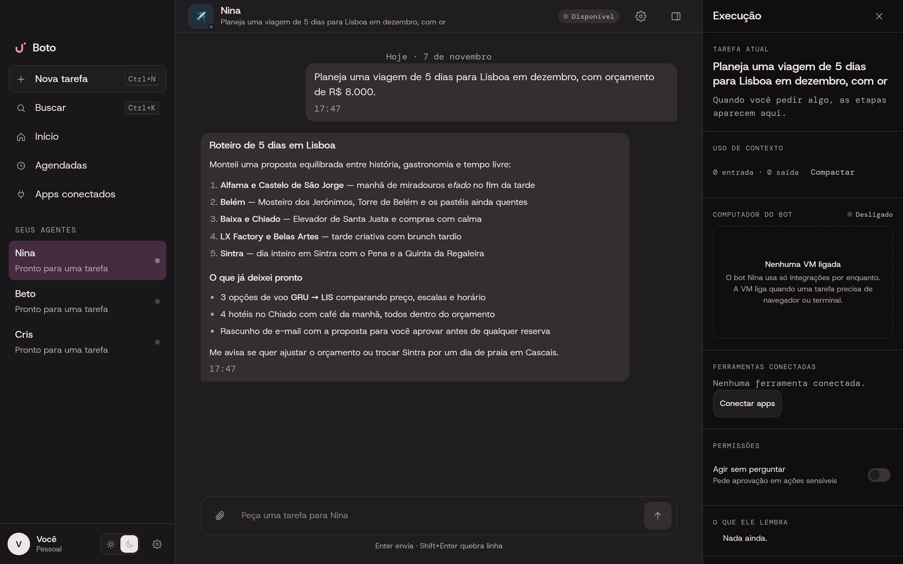
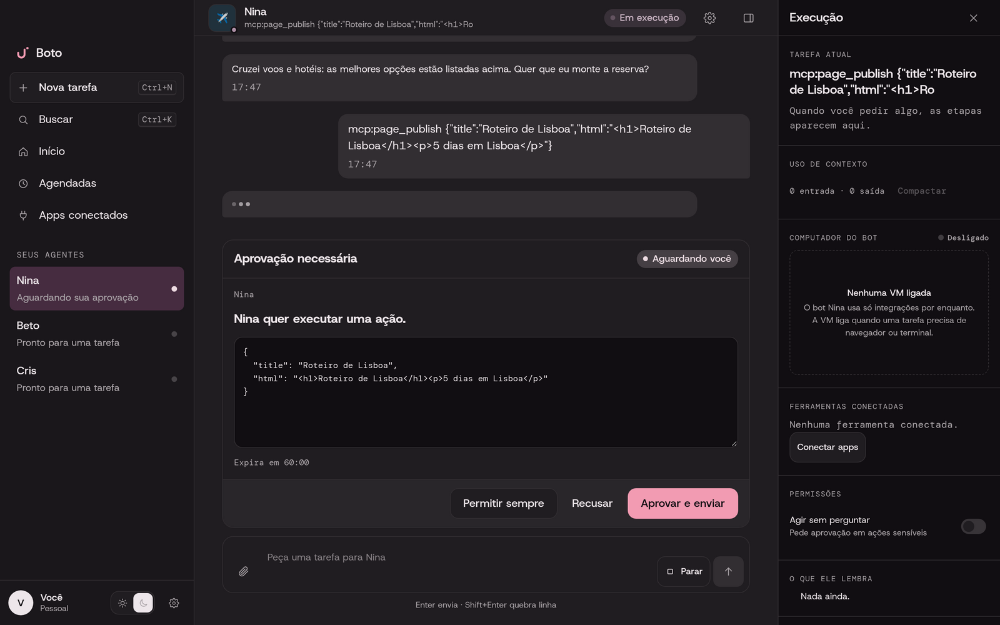
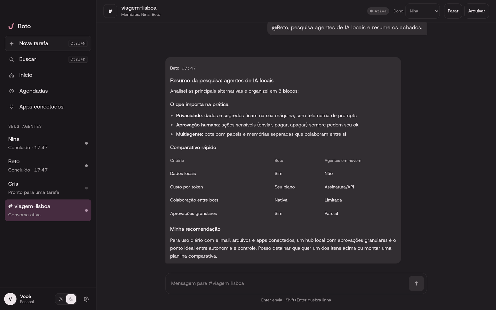
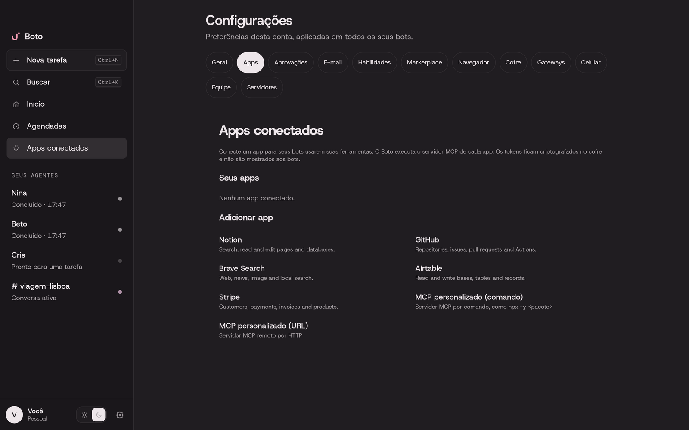
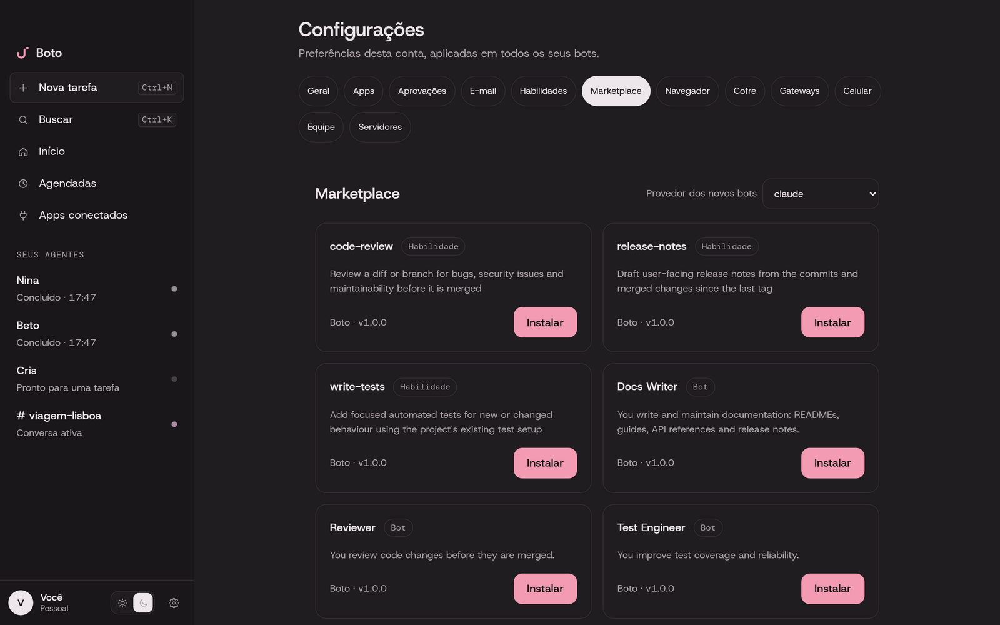

<p align="center">
  <picture>
    <source media="(prefers-color-scheme: dark)" srcset="apps/desktop/public/assets/boto-logo-branco.svg">
    <source media="(prefers-color-scheme: light)" srcset="apps/desktop/public/assets/boto-logo.svg">
    
  </picture>
</p>

<h3 align="center">Your own team of AI bots, living on your desktop</h3>

<p align="center">
  <a href="https://github.com/fazedordecodigo/boto/actions/workflows/ci.yml"></a>
  <a href="https://github.com/fazedordecodigo/boto/releases"></a>
  <a href="LICENSE"></a>
  
</p>

<p align="center">
  
</p>

## What is Boto

Boto is a local-first desktop app for a **team of AI bots** that work together on your
everyday tasks: researching the web, organizing files, drafting e-mails and documents,
and using your connected apps. Each bot has its own name, role, memory and chat — they
message each other, delegate work and share a workspace, and ask before doing anything
consequential.

Everything runs on your machine. Bots, chats and secrets stay in `~/Boto` (or the
platform equivalent), secrets live in an encrypted vault, and nothing is sent or written
on your behalf without your approval. The bots' brains are the AI agents you already use —
Claude Code, Codex, Devin, Cursor, Grok, OpenCode and Gemini (ACP).

## Features

- **A team, not a chatbot** — bots with their own roles and memories collaborate in group
  chats you can watch and steer.
- **Bots that do real work** — browse the web, manage files, read your e-mail and prepare
  drafts (only you send), and publish HTML reports and trackers to a local Pages library.
- **You're always in control** — granular approval rules, secure secret requests, browser
  take-over for sign-ins, native notifications and pending-approval badges on every OS.
- **Connected apps** — Notion, GitHub, Brave Search, Airtable, Stripe or any MCP server,
  shared with the bots you choose; tokens stay in the vault.
- **Reachable everywhere** — Telegram, Slack, Discord, a mobile companion on your LAN,
  team relay, and routines on schedules and webhooks.
- **Built to grow** — skills library, marketplace of skills and bot templates, bots created
  from a prompt, and bots running on your Mac/PC or on your own Linux VPS in Firecracker
  microVMs.

| Approvals | Group chats |
|---|---|
|  |  |
| **Connected apps** | **Marketplace** |
|  |  |

## Install

Download the installer for your OS from [Releases](https://github.com/fazedordecodigo/boto/releases):

- **macOS:** install the `.dmg`; the app updates itself. Signed and notarized builds open
  normally. For unsigned builds, open System Settings → Privacy & Security and click
  **Open Anyway** (or run `xattr -cr /Applications/Boto.app`).
- **Windows x64 / ARM64:** run the matching per-user `.exe` installer. SmartScreen may warn
  on unsigned builds: choose **More info → Run anyway**.
- **Linux x64 / ARM64:** use the `.AppImage` for in-app updates (`chmod +x Boto_*.AppImage`),
  or install the `.deb` with `sudo apt install ./Boto_*.deb` or the `.rpm` with
  `sudo dnf install ./Boto-*.rpm`. Packages do not self-update.

On Linux, install `libsecret-tools` to keep the vault key in Secret Service (otherwise a
plaintext key file with owner-only permissions is used, with a startup warning). Computer
Use needs `xdotool` and a screenshot tool (`import`, `scrot` or `gnome-screenshot`) and
remains opt-in per bot; read-aloud uses `espeak-ng` when available.

## Evolution

Boto was BobAgent, then UpBot, and is now Boto — each rename migrated your bots, chats and
vault automatically. The next release is **0.5.0**, which brings:

- the new Eco design system (dark theme, Host Grotesk and DM Mono fonts) and a
  Brazilian Portuguese interface;
- native approval notifications on Linux (freedesktop D-Bus) and pending-approval badges
  on macOS, Windows and Linux;
- a persistent approval audit trail, interrupted-approval recovery after restarts, and
  Devin and Grok running inside Firecracker microVMs;
- routine run history, skill versioning and many reliability fixes.

See the [changelog](CHANGELOG.md) for the full history.

### Upgrading from UpBot

Quit the old app before starting Boto. It moves `~/UpBot` (or `~/BobAgent`) to `~/Boto`,
repoints bot workspaces, migrates the app data directory to `com.boto.desktop` and keeps
your vault readable. Custom `UPBOT_*` environment variables become `BOTO_*`; for remote
hosts, reinstall from Settings → Hosts and rebuild the microVM rootfs. Details and edge
cases: [AGENTS.md](AGENTS.md#bots-general-purpose).

## Run bots on your own server

Point Boto at a Linux VPS and each bot session can run there instead — as a plain process
or inside its own Firecracker microVM, with credentials delivered only inside the VM.
Setup guide, host requirements and microVM internals:
[docs/remote-hosts.md](docs/remote-hosts.md).

## Develop

```sh
bun install
bun run dev          # sidecar + tauri dev
bun run test         # daemon e2e tests
bun run lint && bun run typecheck
```

Architecture and conventions: [AGENTS.md](AGENTS.md). Contributions are welcome — see the
[contributing guide](CONTRIBUTING.md).

## Fonts

The desktop app bundles Host Grotesk and DM Mono under the SIL Open Font License 1.1;
the license texts ship in `apps/desktop/src/fonts/`.

## License

[MIT](LICENSE)
